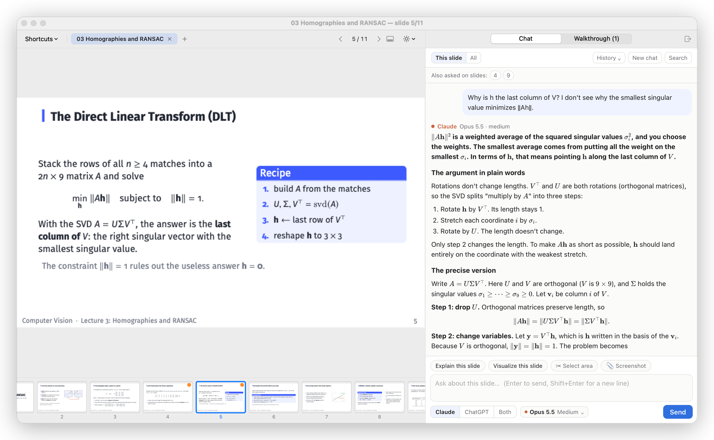
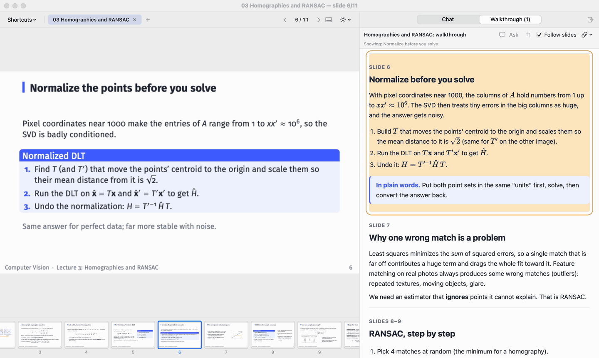
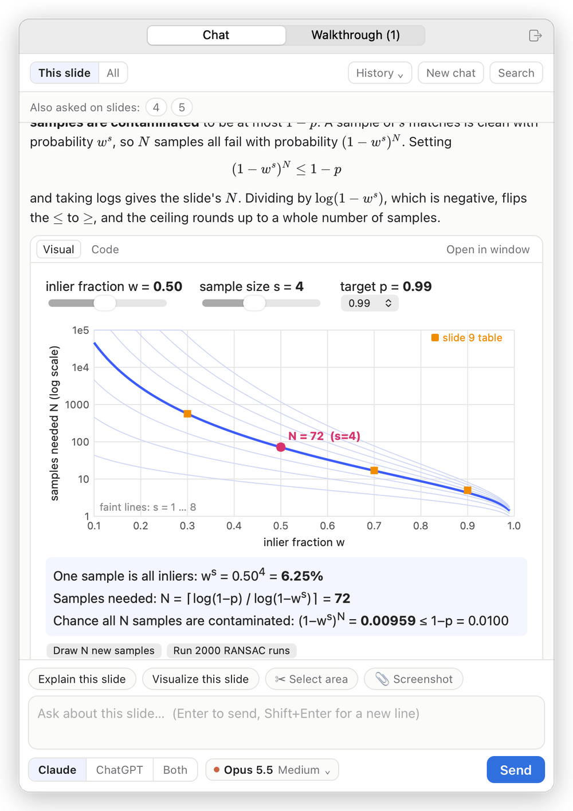
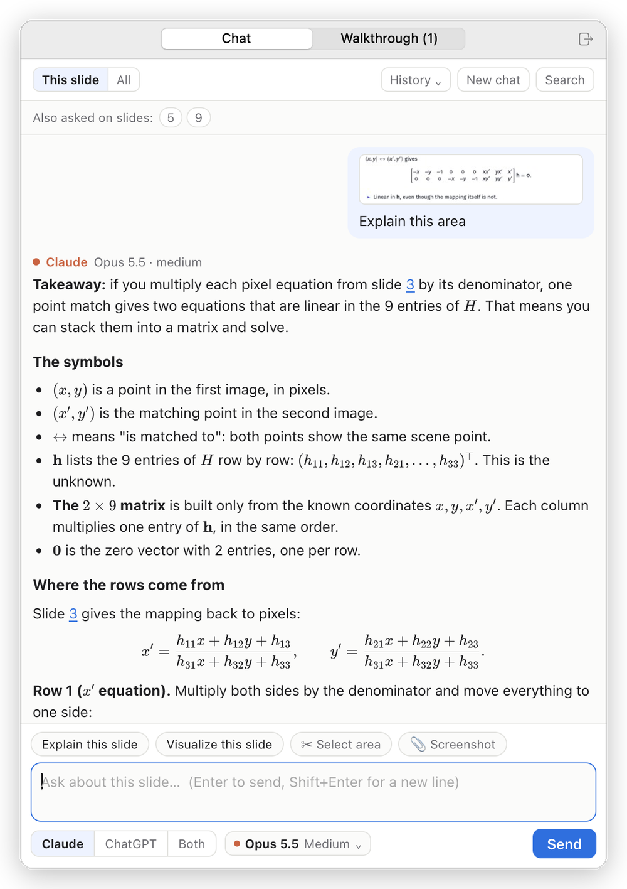
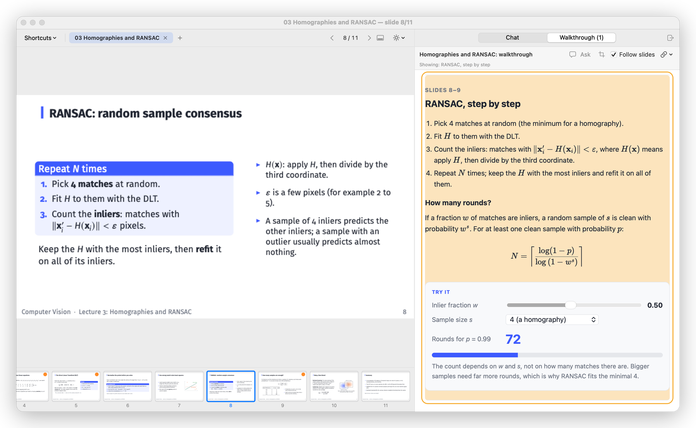
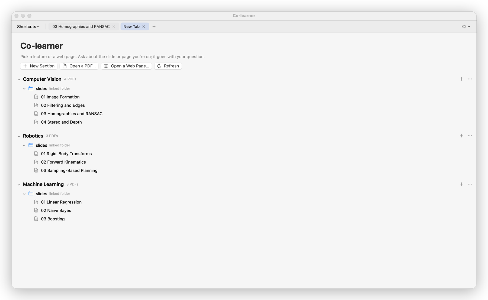
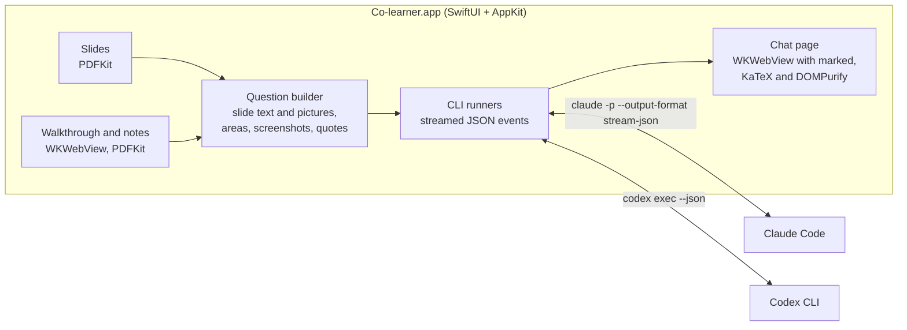

<div align="center">


# Co-learner

**Study lecture slides with an AI tutor beside them.**

A native macOS app that puts your slides, a Claude and ChatGPT chat that knows which slide you are on,<br>
and your study notes in one window. Turn a slide, and the notes scroll to match.


</div>

<picture>
  <source media="(prefers-color-scheme: dark)" srcset="docs/images/hero-dark.png">
  
</picture>

## Why I built it

Reviewing a lecture used to mean the slides on an iPad, ChatGPT in one browser tab, Claude in another, and a long study guide on a second screen. Every question started with "on slide 14, ...". Co-learner keeps all of it in one window: the assistants always know which slide you are looking at, and so do your notes.

## What it does



<sub>Turning the slides scrolls the walkthrough to the matching section. Then a question about slide 8, answered live by Claude (the GIF runs faster than real time).</sub>

### Ask about the slide you are on

- **One conversation per lecture.** The assistants get the deck's text up front and each slide's picture the first time it comes up. Every question says which slide you are on, and slides you mention ("compare with slide 3") go along with it.
- **Explain** or **Visualize** in one click. A Visualize answer arrives as a live, interactive diagram inside the chat.
- **Point at exactly what you mean:** drag a box over part of a slide, paste a screenshot with ⌘V, select a passage in your notes, or quote part of an earlier answer with **Reply**.
- **Claude, ChatGPT, or Both.** The two share the conversation, so each sees what the other said. Model and effort are picked per assistant.
- Math renders with KaTeX, and "slide 7" in an answer is a link that takes you there.

<table>
  <tr>
    <td width="50%"></td>
    <td width="50%"></td>
  </tr>
  <tr>
    <td><sub><b>Visualize this slide.</b> Claude wrote an interactive demo of how many RANSAC rounds you need.</sub></td>
    <td><sub><b>Explain this area.</b> Only the matrix equation was boxed and sent with the question.</sub></td>
  </tr>
</table>

### Notes that follow the slides

- The **Walkthrough** tab shows your study page for the deck and scrolls to the section about the slide on screen.
- Typed **LaTeX lecture notes** open at the page that shows the current slide. The match comes from the page stamps pdfTeX writes into every slide a document includes, so no table has to be kept by hand.
- **Ask about this:** select a passage in the notes and send it to the chat as a quote (its math stays TeX).

<picture>
  <source media="(prefers-color-scheme: dark)" srcset="docs/images/walk-dark.png">
  
</picture>

### A library that keeps up with Finder

- Lectures live in **sections** of linked folders and single PDFs, shown as they are on disk. Drag between sections, reorder, and rename files from the app.
- **Rename or move a PDF in Finder** and its chats, its place, its tabs and its notes follow it (file IDs, bookmarks and FSEvents).
- **Web tabs** open online textbooks, with a chat of their own that reads the page you are on. **Search** finds any answer in any chat (⇧⌘F).
- Pop the chat or the notes out to a second screen, such as an iPad with Sidecar.

<picture>
  <source media="(prefers-color-scheme: dark)" srcset="docs/images/library-dark.png">
  
</picture>

## How it works



Co-learner has no API keys and no server. It runs the Claude Code and Codex command-line tools that are already signed in on your Mac, streams their JSON events into the chat page, and resumes the same Claude session and Codex thread for every follow-up in a conversation. So answers count against your own Claude and ChatGPT plans, and the app's live **Usage** menu shows how much of each plan window is left.

## Install

You need:

- macOS 14 or later (developed and tested on macOS 27) and the Command Line Tools (`xcode-select --install`). Xcode itself is not needed.
- [Claude Code](https://github.com/anthropics/claude-code), the [Codex CLI](https://github.com/openai/codex), or both, installed and signed in.

```bash
git clone https://github.com/yifei-dai/colearner.git
cd colearner
scripts/build_app.sh --install
```

This builds `Co-learner.app` and copies it to `~/Applications`. Open it, click **New Section**, then **+** to link a folder of lecture PDFs. If an assistant's login expires, the failed answer offers **Sign in**, which runs that tool's own sign-in in Terminal.

## Shortcuts

| | |
|---|---|
| Next or previous slide | → ← |
| Ask | Return (Shift-Return for a new line) |
| Ask about part of a slide | ✂︎ Select area, ⌥-drag on the slide, or ⇧⌘A |
| Ask about a screenshot | ⌘V in the chat, or drop picture files on it |
| Ask about the notes | select text, then **Ask about this**, or ⇧⌘L |
| Chat or Walkthrough tab | ⌘1, ⌘2 |
| Pop out Chat or Walkthrough | ⌥⌘1, ⌥⌘2 |
| New tab with the lecture list | ⌘T |
| Search all chats | ⇧⌘F |

The [user guide](docs/USER_GUIDE.md) covers everything else.

## Privacy and safety

- Your slides, notes and chats stay on your Mac (chats in `~/Library/Application Support/Co-learner/`). What goes out is what any Claude Code or Codex session sends: the question and what goes with it.
- Claude runs with read-only tools (Read, Grep, Glob), no MCP servers and no settings or memory files, and can read only the open deck's folders and its study pages. Codex runs in a read-only sandbox with shell commands and web search off.
- In a web tab, neither assistant gets any tools, and both are told that page text is reference material, not instructions.
- The clipboard is read only when you paste, so macOS never asks for clipboard access.

## Development

- `swift run` starts a debug build. `scripts/test.sh` runs the 185 tests in 20 suites (two of them opt-in) without any network: fake CLI executables, temporary chats, generated PDFs and real WebKit pages.
- [Development notes](docs/DEVELOPMENT.md): how the app talks to each CLI, how the library finds study pages, building, testing, and a map of the source files.
- [Changelog](docs/CHANGELOG.md): what changed in each version, from 0.1 on October 17, 2026.
- The pictures above come from a debug build driven by `COLEARNER_SCRIPT` on a demo lecture written for it ([docs/demo](docs/demo)). The answers in them are real Claude answers.

## How it was built

I designed Co-learner for my own studying and use it to review my lectures. The code was written with [Claude Code](https://github.com/anthropics/claude-code) as my coding agent, which is why the commits carry a `Co-Authored-By: Claude` line. My part was deciding what the app should do, specifying each feature, and testing every release in my own studying; the larger releases also went through code reviews by separate AI agents, and each confirmed finding was fixed with a regression test. Twelve releases have shipped since October 17, 2026; every one after the first came from a round of my own feedback.

## Acknowledgements

The chat page uses [KaTeX](https://katex.org) (MIT), [marked](https://marked.js.org) (MIT) and [DOMPurify](https://github.com/cure53/DOMPurify) (Apache 2.0 or MPL 2.0), vendored in `Sources/CoLearner/Web/vendor` with their licenses.
